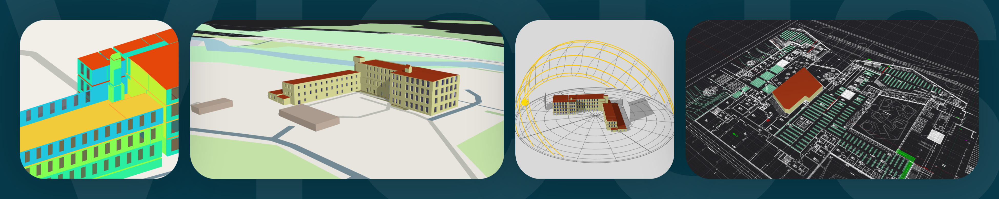

# SIM-VICUS
_NEXT LEVEL BUILDING AND DISTRICT ENERGY SIMULATION_

SIM-VICUS is a 3D modeling environment for building and district networks and an innovative dynamic simulation engine (NANDRAD). 

The software is now being developed by _VICUS-Software GmbH_ and is available on their webpage: https://vicus-software.com

